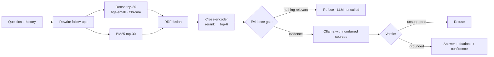

# DocIntel - AI Document Intelligence Platform

Ask natural-language questions about your **PDF, DOCX and TXT** files and get
**grounded answers with page-level citations**. When the documents don't
support an answer, DocIntel says so instead of guessing.

Everything runs locally on open-source models: Sentence Transformers for
embeddings and reranking, ChromaDB for vectors, and an Ollama-hosted LLM. No
OpenAI key, and no document ever leaves your machine.

```
React/TS UI ──► FastAPI ──► hybrid retrieval (bge-small dense ∥ BM25 → RRF → cross-encoder)
                   │                 │
              PostgreSQL         ChromaDB          ──► Ollama (llama3.2 / qwen2.5) ──► answer verifier
```

## Highlights

- **Page-aware ingestion.** Per-page PDF extraction, DOCX parsing that keeps
  headings, tables and Word's page breaks, and TXT with encoding detection.
  Text is cleaned (ligatures, de-hyphenation, running headers and footers) and
  chunked by structure with `page_start`/`page_end` and section paths.
- **Hybrid retrieval.** Dense (bge-small + ChromaDB) and sparse (BM25)
  retrieval are fused with Reciprocal Rank Fusion, then **reranked by a
  cross-encoder**. Chunks get contextual headers (`title > section`) so short
  passages still retrieve.
- **Hallucination guardrails, in layers:**
  - A two-signal evidence gate refuses before the LLM is called.
  - The prompt is constrained to numbered sources.
  - The answer is verified afterwards: refusal detection, removal of citations
    to non-existent sources, careful citation repair, a grounding score, and
    exact checks on figures.
- **Conversations.** Follow-up questions are rewritten into standalone search
  queries, and the history is passed to the LLM. Each conversation can be
  scoped to selected documents.
- **Streaming UX.** Answers stream over Server-Sent Events. Clickable `[n]`
  chips link to a source panel showing the passage, page, section, relevance
  and retrieval diagnostics.
- **Measured, not assumed.** An evaluation harness reports Recall@k, MRR,
  nDCG, page accuracy, citation accuracy and hallucination rate. **Hybrid +
  rerank reaches recall@1 = 1.0 with 0 hallucinations** on the bundled
  benchmark ([details](docs/evaluation.md)).
- **Production-style engineering.** Clean layered architecture with protocol
  interfaces, Pydantic validation, a consistent error envelope with request
  IDs, Alembic migrations, health and readiness probes, Docker Compose, and
  GitHub Actions CI. Tests: 206 backend (unit, integration, evaluation,
  adversarial hallucination; 93% coverage) and 16 frontend.

## Contents

- [Quick start (Docker)](#quick-start-docker)
- [Local development](#local-development)
- [How it works](#how-it-works)
- [Evaluation](#evaluation)
- [Testing](#testing)
- [Configuration](#configuration)
- [Project structure](#project-structure)
- Docs: [Architecture](docs/architecture.md) · [API](docs/api.md) · [Evaluation](docs/evaluation.md) · [Demo walkthrough](docs/demo.md)

## Quick start (Docker)

Requirements: Docker with Compose v2.24+, ~8 GB RAM, ~6 GB disk.

```bash
cp .env.example .env              # optionally change POSTGRES_PASSWORD / OLLAMA_MODEL
docker compose up -d --build
docker compose logs -f ollama-init   # first run downloads the LLM (~2 GB for llama3.2:3b)
```

| URL | What |
|---|---|
| <http://localhost:3000> | Web app |
| <http://localhost:8000/docs> | Interactive API docs (Swagger) |
| <http://localhost:8000/api/v1/health/ready> | Dependency health |

The stack runs **PostgreSQL**, **ChromaDB**, **Ollama** (plus a one-shot model
pull), the **backend** (embedding and reranking models baked into the image)
and the **frontend** (nginx, which also proxies `/api`). Data lives in named
volumes.

- **NVIDIA GPU:** `docker compose -f docker-compose.yml -f docker-compose.gpu.yml up -d`
- **Ollama already installed on the host:** set
  `DOCKER_OLLAMA_BASE_URL=http://host.docker.internal:11434` in `.env` and run
  `docker compose up -d postgres chroma backend frontend`.
- **Better answers:** `OLLAMA_MODEL=qwen2.5:7b` or `llama3.1:8b` (more RAM, slower on CPU).

Then follow the [demo walkthrough](docs/demo.md).

## Local development

Requirements: Python 3.11+, Node 22+/24, and optionally Ollama and PostgreSQL.

```bash
# Backend
cd backend
python -m venv .venv && source .venv/bin/activate       # Windows: .venv\Scripts\activate
pip install torch --index-url https://download.pytorch.org/whl/cpu
pip install -e ".[ml,dev]"
cp ../.env.example .env
```

Zero-infrastructure mode: SQLite, an embedded Chroma, and no LLM required.
Edit `backend/.env`:

```bash
DATABASE_URL=sqlite:///./data/docintel.db
VECTOR_STORE=chroma-persistent
LLM_PROVIDER=fake            # or keep "ollama" and run `ollama serve` + `ollama pull llama3.2:3b`
```

```bash
uvicorn app.main:app --reload --port 8000        # http://localhost:8000/docs
```

```bash
# Frontend (second terminal) - proxies /api to :8000
cd frontend
npm ci
npm run dev                                      # http://localhost:5173
```

To use PostgreSQL locally, start only the infrastructure with
`docker compose up -d postgres chroma ollama` and keep the default
`DATABASE_URL` / `VECTOR_STORE=chroma-http`. Schema changes go through Alembic:
`alembic revision --autogenerate -m "..."` then `alembic upgrade head`.

A `Makefile` wraps the common commands (`make up`, `make test`, `make lint`,
`make eval-real`, ...).

## How it works



1. **Ingestion** (`app/ingestion/`). The upload is validated (extension, magic
   bytes, streamed size limit, SHA-256 dedupe) and returns `202`. A bounded
   worker pool then parses → cleans → segments into headings, paragraphs,
   lists and tables → chunks into sentence units (128 tokens, 24-token
   overlap, section-aligned). It embeds `title > section + text` and writes
   vectors to Chroma, chunk text and pages to PostgreSQL, and terms to BM25.
2. **Retrieval** (`app/rag/retriever.py`). Dense and BM25 candidates are fused
   with RRF. The top 20 are reranked by the cross-encoder, and the top 6 go to
   the LLM.
3. **Generation** (`app/rag/pipeline.py`, `prompts.py`). A strict system
   prompt, the numbered sources (filename, title, page, section) and recent
   history are sent to the model. It must cite `[n]` or reply
   `INSUFFICIENT_EVIDENCE`.
4. **Verification** (`app/rag/grounding.py`). Refusal detection, removal of
   invalid citations, citation repair for faithful but uncited sentences,
   grounding score, and unsupported-number detection. Together these produce
   `confidence` (high/medium/low) or a refusal with a machine-readable
   `refusal_reason`.

See [docs/architecture.md](docs/architecture.md) for the diagrams, data model
and trade-offs.

## Evaluation

```bash
cd backend
python -m evaluation.run --models real            # retrieval metrics + guardrails
python -m evaluation.run --models real --llm ollama   # plus answers from your local LLM
```

A synthetic, *fictional* corpus (PDF + DOCX + 2× TXT, including a distractor
with conflicting facts) with 26 answerable and 10 unanswerable questions:

| mode | recall@1 | recall@3 | MRR | nDCG@5 | page acc. |
|---|---|---|---|---|---|
| semantic (bge-small) | 0.923 | 0.962 | 0.950 | 0.962 | 1.000 |
| lexical (BM25) | 0.808 | 1.000 | 0.897 | 0.924 | 1.000 |
| hybrid (RRF) | 0.923 | 1.000 | 0.962 | 0.972 | 1.000 |
| **hybrid + cross-encoder** | **1.000** | **1.000** | **1.000** | **1.000** | **1.000** |

**Citation accuracy 100% · unanswerable questions refused 10/10 · 0
hallucinations.** The evaluation also changed the design: it showed that a
cross-encoder-only evidence gate cannot tell paraphrases from unanswerable
on-topic questions, which led to the two-signal gate
([write-up](docs/evaluation.md#what-the-evaluation-changed)).

## Testing

```bash
cd backend && pytest                    # 204 tests (+2 opt-in): unit, integration, evaluation, hallucination - 93% coverage
cd backend && RUN_ML_EVAL=1 pytest -m "ml or chroma"   # quality gate with the real models + ChromaDB
cd frontend && npm test                 # 16 component / unit tests (Vitest + Testing Library)
```

| Suite | Covers |
|---|---|
| `tests/unit` | Cleaning, layout heuristics, PDF/DOCX/TXT parsers (generated real files), chunking invariants, BM25, RRF, rerankers, vector store, citation parsing and repair, grounding, Ollama client (mocked transport), query rewriting, pipeline orchestration |
| `tests/integration` | Full HTTP API: upload lifecycle, validation errors (413/415/409/404/422), failed parsing and reprocessing, chat with citations, refusals, document scoping, conversation history, SSE streaming, LLM outage → 503, ChromaDB store |
| `tests/evaluation` | Retrieval-quality gates (hybrid ≥ single retrievers, recall/MRR floors), zero hallucinations on unanswerable questions, adversarial scripted-LLM attacks |

CI (`.github/workflows/ci.yml`) has five jobs:

1. Lint, format and mypy, then the full test suite on SQLite.
2. Integration tests and Alembic migration and drift checks on **PostgreSQL**.
3. The real-model retrieval evaluation, with its report published to the job
   summary.
4. Frontend type-check, tests and build.
5. Docker image builds and Compose validation.

## Configuration

All settings are environment variables, validated at start-up. The full list
with defaults is in [`.env.example`](.env.example). The ones that matter most:

| Variable | Default | Purpose |
|---|---|---|
| `OLLAMA_MODEL` | `llama3.2:3b` | Any Ollama chat model |
| `EMBEDDING_MODEL` | `BAAI/bge-small-en-v1.5` | Any Sentence Transformers model (re-process documents after changing) |
| `RERANKER_PROVIDER` / `RERANKER_MODEL` | `cross-encoder` / `ms-marco-MiniLM-L-6-v2` | `lexical` disables the neural reranker |
| `CHUNK_SIZE_TOKENS` / `CHUNK_OVERLAP_TOKENS` | `128` / `24` | Chunking granularity |
| `RETRIEVAL_TOP_K` | `6` | Chunks shown to the LLM |
| `MIN_RELEVANCE_SCORE` / `MIN_SEMANTIC_SCORE` | calibrated (`0.1` / `0.5`) | Evidence gate thresholds |
| `STRICT_GROUNDING` | `false` | Also refuse weakly grounded answers |
| `VECTOR_STORE` | `chroma-http` | `chroma-persistent` (embedded) or `memory` |
| `LLM_PROVIDER` | `ollama` | `fake` = extractive test double, no model needed |

## Project structure

```
backend/
  app/
    api/            routes (documents, chat, conversations, system) + dependencies
    core/           settings, logging (request IDs, JSON), exceptions, text utilities
    db/             SQLAlchemy models, session management
    ingestion/      parsers (pdf, docx, txt), cleaning, chunking, pipeline + queue
    rag/            embeddings, vector store, BM25, fusion, reranker, retriever,
                    LLM clients, prompts, query rewriter, grounding, pipeline
    repositories/   data access
    services/       document & chat use-cases, upload storage
    container.py    composition root (wires components from settings)
    main.py         FastAPI app factory
  alembic/          database migrations
  evaluation/       synthetic corpus, dataset, metrics, harness, CLI, reports/
  tests/            unit / integration / evaluation
frontend/
  src/api/          typed client, SSE parser
  src/hooks/        TanStack Query hooks, streaming chat state
  src/components/   chat (answer, sources, scope picker...), documents (upload, chunks)
  src/pages/        Ask, Documents
docs/               architecture, API reference, evaluation, demo, openapi.json
docker-compose.yml  postgres · chroma · ollama · backend · frontend
```

## Limitations and roadmap

- No OCR: scanned PDFs are rejected with a clear message. Tesseract/docTR
  would plug in as another parser.
- Single-user: no authentication or tenancy. Add OIDC plus per-user document
  ownership for shared deployments.
- In-process queue and BM25 suit a single API instance. Swap in Celery/Arq and
  PostgreSQL FTS/OpenSearch behind the existing interfaces to scale out.
- The grounding check is lexical. An NLI- or LLM-judge-based faithfulness check
  would catch paraphrased hallucinations.
- English-tuned models by default. Use `BAAI/bge-m3` plus a multilingual
  reranker for other languages.

## License

MIT
"# AI-document-intelligence-platform" 
