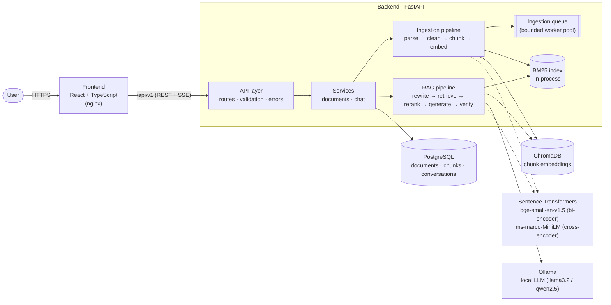
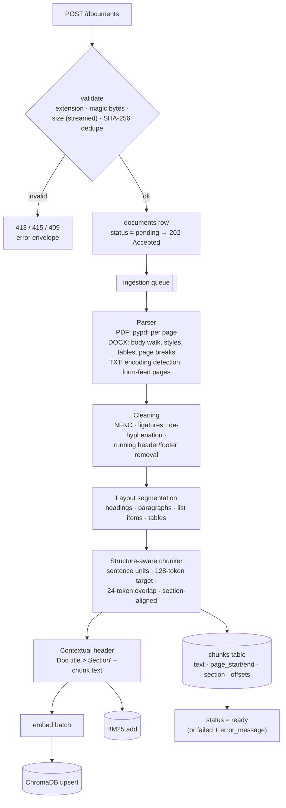
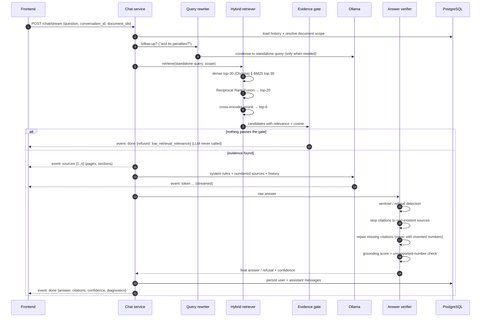
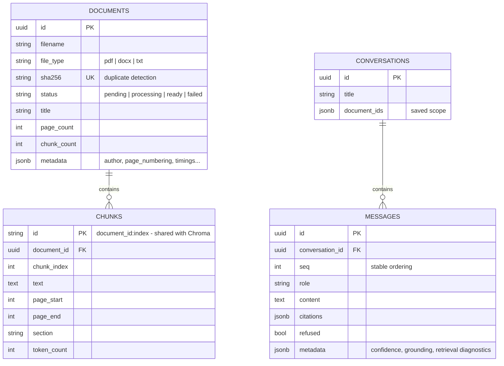

# Architecture

DocIntel is a retrieval-augmented generation (RAG) system built from small,
swappable components behind protocols. Everything runs locally: no data leaves
the machine and no paid API is required.

## 1. System overview

| Component | Technology | Responsibility |
|---|---|---|
| Frontend | React 19, TypeScript, TanStack Query, Vite | Upload, document dashboard, streaming chat, citation panel |
| API | FastAPI, Pydantic v2 | Validation, routing, consistent error envelope, SSE streaming |
| Metadata store | PostgreSQL 17 (SQLAlchemy 2, Alembic) | System of record for documents, **chunk text + page provenance**, conversations |
| Vector store | ChromaDB 1.5 (HNSW, cosine) | Dense vectors keyed by chunk id - rebuildable from PostgreSQL |
| Lexical index | In-process BM25 | Exact-term recall (IDs, numbers, acronyms); rebuilt from PostgreSQL at start-up |
| Embeddings | `BAAI/bge-small-en-v1.5` | 384-d bi-encoder, query instruction prefix |
| Reranker | `cross-encoder/ms-marco-MiniLM-L-6-v2` | Precise relevance scoring of fused candidates |
| LLM | Ollama (`llama3.2:3b` default) | Grounded answer generation with citation markers |

**Composition root.** `app/container.py` builds every long-lived component from
`Settings`. Each one sits behind a `Protocol` (`Embedder`, `VectorStore`,
`Reranker`, `LLMClient`). Tests and CI swap in deterministic fakes - hashing
embedder, in-memory vector store, lexical reranker, extractive fake LLM -
**through the same code path**, so the HTTP API, ingestion and guardrails are
exercised for real without downloading models.

## 2. Ingestion pipeline

Design notes:

* **Page provenance is first-class.** Every block carries its page. Chunks
  record `page_start`/`page_end`, so a chunk that spans a page break cites
  `pp. 3-4`. DOCX has no stored pagination, so we use Word's
  `lastRenderedPageBreak` markers when present and fall back to explicit page
  breaks. When neither exists, pages are reported as unknown rather than
  invented.
* **Chunks follow document structure.** Units are sentences, never split
  mid-sentence. A new chunk starts at each heading once the current chunk has
  real content, and overlap never crosses a section boundary. Each chunk is
  labelled with its heading path (`Policies > Security`).
* **Contextual chunk headers.** The text that is embedded and BM25-indexed is
  prefixed with `title > section`. A chunk such as "It must be renewed yearly."
  then still retrieves for "passport renewal policy".
* **Idempotent and failure-safe.** Re-processing deletes the old vectors first.
  Any failure marks the row `failed` with a readable message and cleans up
  partial vectors. Jobs interrupted by a restart are marked failed at start-up
  so they can be re-queued explicitly.

## 3. Question answering pipeline

### Hybrid retrieval

| Stage | Why |
|---|---|
| **Dense** (bge-small, cosine HNSW) | Paraphrases and semantics ("Can I work from abroad?" → "working from another country") |
| **Sparse** (BM25, k1=1.5, b=0.75, light stemming) | Exact identifiers, numbers, rare terms ("clause 14.3", "REBCO", "Ledgerly") |
| **Reciprocal Rank Fusion** (k=60) | Combines rankings without calibrating cosine scores against unbounded BM25 scores |
| **Cross-encoder rerank** | Reads query and passage *together* - much more precise than either retriever; its score feeds the evidence gate |

### Hallucination guardrails (defence in depth)

1. **Two-signal evidence gate (before the LLM).** A chunk counts as evidence
   when its cross-encoder relevance is at least 0.1 **or** its dense cosine
   similarity is at least 0.5. If nothing qualifies, the system refuses without
   calling the LLM. The thresholds were calibrated on the evaluation set
   ([evaluation.md](evaluation.md)):
   * Cross-encoders under-score paraphrases ("vacation" vs "annual leave" ≈ 0.0001).
   * They over-score on-topic questions the text doesn't answer ("When does
     *Phase III* start?" ≈ 0.999).

   So the gate only rejects clearly off-topic questions. Deciding answerability
   is left to the next layers.
2. **Constrained prompt.** The model may only use the numbered sources, must
   cite them with `[n]`, and must reply `INSUFFICIENT_EVIDENCE` when the sources
   do not answer the question. Temperature is 0.1.
3. **Post-generation verification.**
   * Sentinel and refusal-phrase detection.
   * Citations to sources that don't exist are removed. If nothing valid
     remains, the answer is refused.
   * Faithful answers that merely *forgot* citations are repaired by
     attributing each sentence to its best-overlapping source. This is never
     done for a sentence containing a number absent from that source, and never
     when the model cited non-existent sources.
   * A lexical **grounding score** measures the share of answer content words
     found in the sources each sentence cites. Figures are checked exactly.
     Together these give the confidence label, and `STRICT_GROUNDING=true` also
     refuses weakly grounded answers.
4. **Transparency.** Every answer returns its sources (cited and retrieved
   ones), relevance scores, the standalone query, and per-stage timings. The UI
   shows them in the source panel.

## 4. Data model

PostgreSQL holds the chunk text, so the vector store and BM25 index are
**derived data**: both can be rebuilt from the database. BM25 is rebuilt on
every start-up, and the vector index is rebuilt by re-processing documents.

## 5. Scaling notes and trade-offs

| Decision | Trade-off / next step at scale |
|---|---|
| In-process ingestion queue (thread pool) | Simple, no broker. For multiple API replicas move to Celery/RQ/Arq behind `IngestionQueue`. |
| In-process BM25 | Microsecond queries, rebuilt in seconds for ~100k chunks. At larger scale use PostgreSQL full-text search or OpenSearch behind the same interface. |
| Single uvicorn worker per container | Models are loaded once per process. Scale horizontally with replicas, not workers. |
| Lexical grounding check | Cheap and deterministic, but paraphrase-blind. An NLI model or LLM-as-judge could be added as a fourth guardrail layer. |
| CPU inference by default | Portable. The GPU compose override and `EMBEDDING_DEVICE=cuda` speed up both embeddings and the LLM. |
| No OCR | Scanned PDFs are rejected with a clear message. Tesseract/docTR can be plugged in as an extra parser. |
| No authentication | Out of scope for a single-user local tool. Add OIDC at the reverse proxy plus per-user document scoping for multi-tenant use. |
